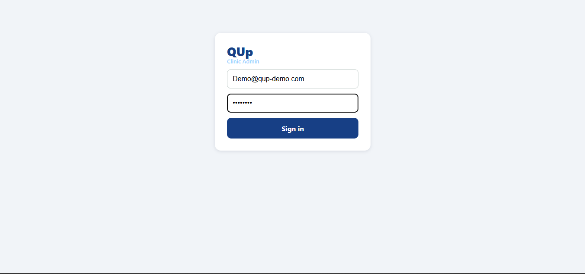
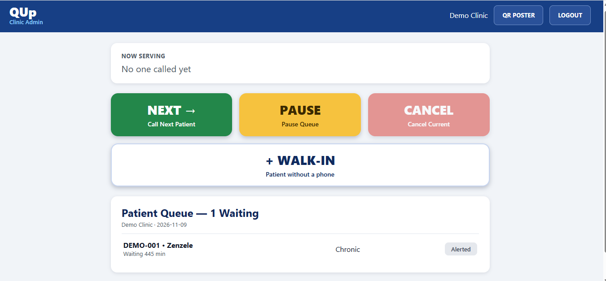
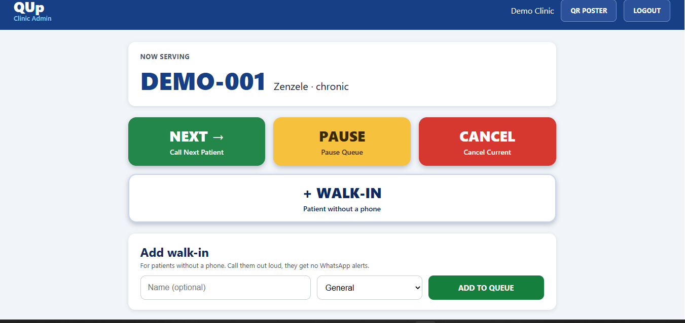
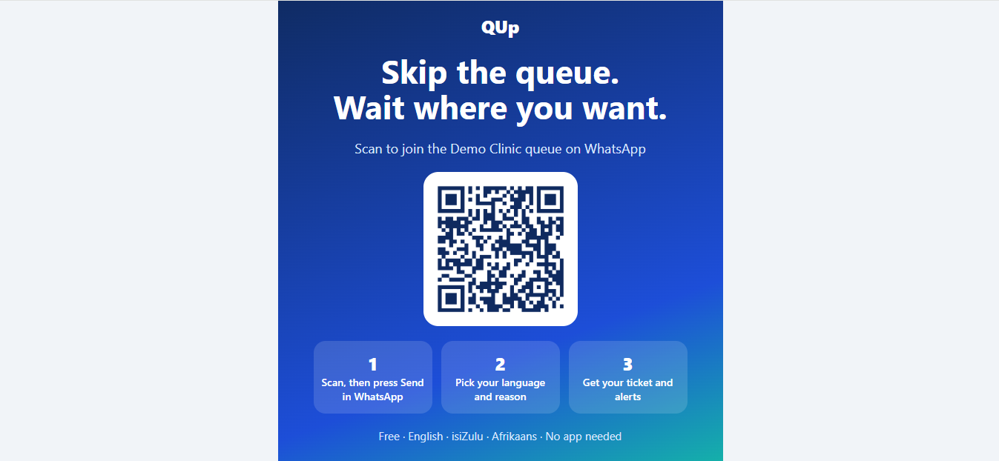
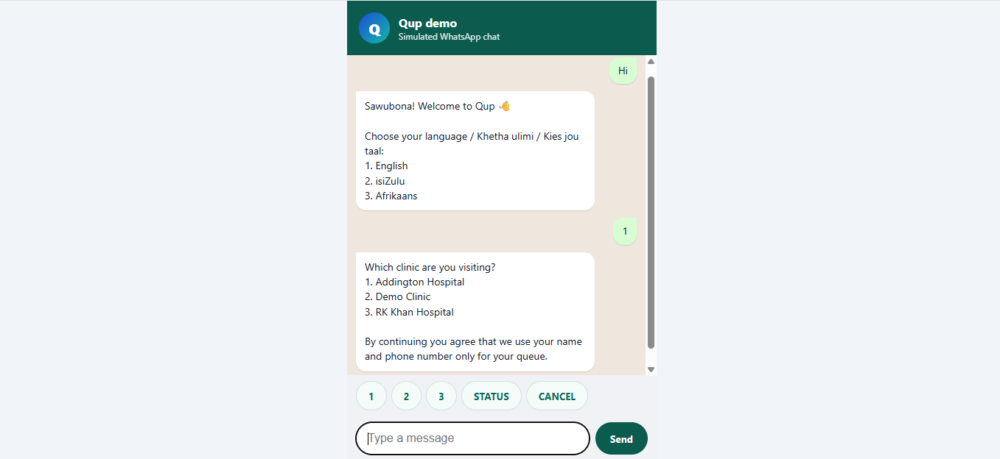
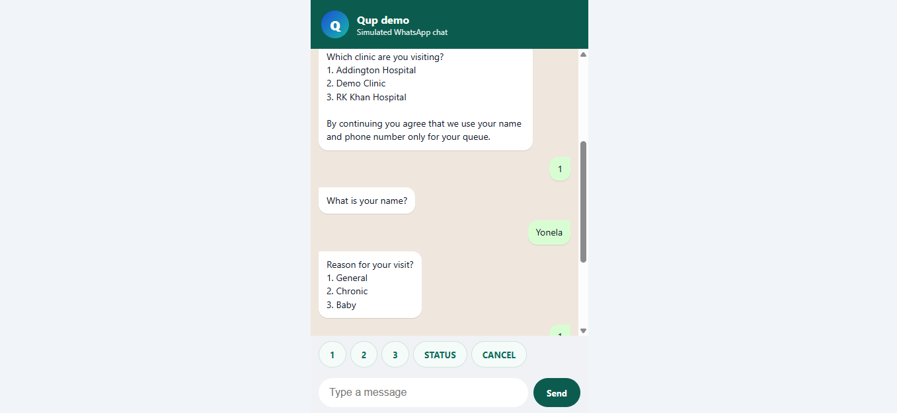
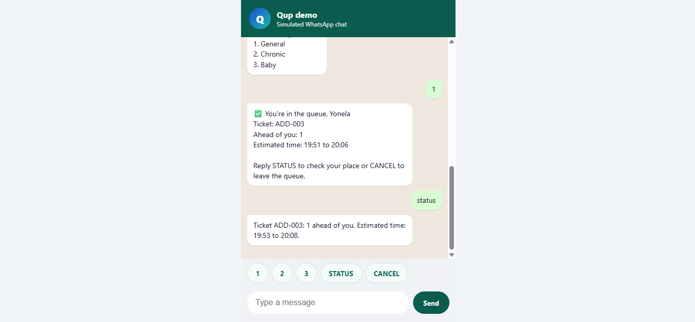
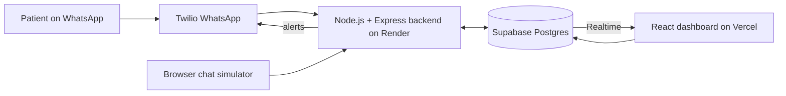

# Qup: WhatsApp queue for clinics

Long waits at public clinics are an everyday problem in South Africa. Qup lets
a patient join a clinic queue by chatting on WhatsApp, wait wherever they like,
and get alerted when their turn is close. Clinic staff run the queue from a
simple live dashboard.

**Live demo**
- Try the patient chat (no WhatsApp needed): https://qup-two.vercel.app/#demo
- Staff dashboard: https://qup-two.vercel.app
  - Email: `Demo@qup-demp.com`
  - Password: `Demo@qup`
  - This login only sees the Demo Clinic.

> The backend runs on a free tier that sleeps when idle. If the chat is slow on
> the first message, wait up to a minute and send again.

## How it works

1. A patient scans a QR code or messages the Qup WhatsApp number.
2. They choose a language (English, isiZulu or Afrikaans), a clinic, give their
   name and pick a reason: General, Chronic or Baby.
3. They get a ticket (for example `ADD-047`), their place in the queue and an
   estimated time window.
4. They reply `STATUS` to check their place or `CANCEL` to leave.
5. Staff press **Next** on the dashboard. The patient is alerted when they are
   close to the front and again when it is their turn.
6. Patients without a phone are added by staff with **Walk-in**, so everyone
   shares one fair queue.

## Features

- WhatsApp conversation flow in three languages
- Live staff dashboard: Next, Pause, Cancel and Walk-in
- Real-time updates with Supabase Realtime
- Per-clinic data isolation with Row Level Security
- Alert notifier that never sends the same alert twice
- Browser chat simulator, so the demo works without WhatsApp
- Printable QR poster for each clinic
- Privacy by design: only a name, phone number and general reason are stored

## Architecture

## Tech stack

| Layer | Tools |
|---|---|
| Backend | Node.js, Express, TypeScript, tsx |
| Database, auth, realtime | Supabase (Postgres, Row Level Security) |
| Staff dashboard | React, Vite, TypeScript |
| WhatsApp | Twilio sandbox (Meta Cloud API support planned) |
| Hosting | Render (backend), Vercel (dashboard) |
| Tests and CI | Vitest, GitHub Actions |
| Other | qrcode, ngrok for local webhook testing |

## Privacy

Qup stores only a name, a phone number and a general reason for the visit. No
medical details are collected in chat, and patients are asked to consent before
joining. This is designed with South Africa's POPIA law in mind. It has not
had a formal compliance review.

## Run it locally

1. Copy `.env.example` to `.env` and fill in the values.
2. Copy `apps/admin/.env.example` to `apps/admin/.env.local` and fill it in.
3. Backend: `cd apps/backend && npm install && npm run dev`
4. Dashboard: `cd apps/admin && npm install && npm run dev`
5. For real WhatsApp testing, expose the backend with `ngrok http 3000` and
   point the Twilio sandbox webhook at `/twilio`.

The database schema is in `supabase/migrations`.

## Project status

This is a portfolio project, not a production service.

- Working: the patient flow, tickets, live dashboard, walk-ins, QR poster and
  the browser simulator.
- Alerts: the notifier logic is built and tested. Delivery to real WhatsApp
  numbers needs a production sender, because the Twilio trial sandbox can't
  send messages the backend starts. The browser simulator shows the alerts.
- Next: Meta Cloud API sender, a verified WhatsApp number and a pilot clinic.

## What I learned

- Designing a conversation flow as a small state machine
- Row Level Security and keeping secret keys on the backend only
- Realtime data with Supabase and idempotent alerts
- Deploying a split backend and frontend, and debugging real hosting issues